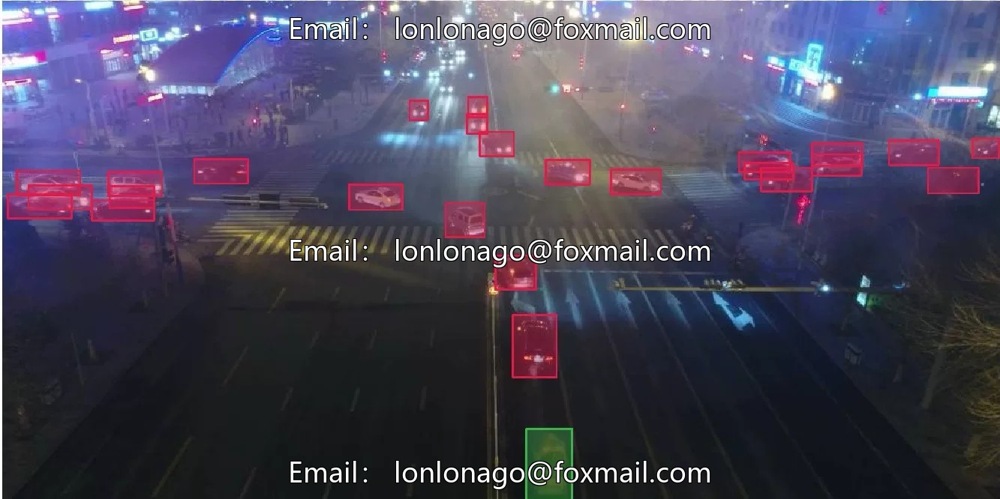
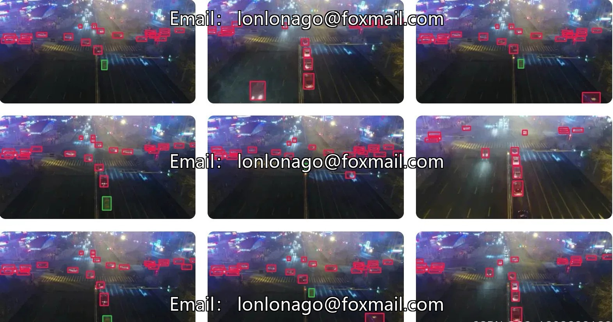
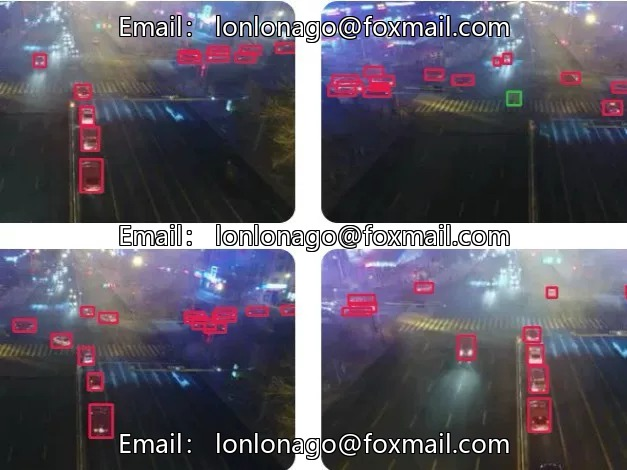
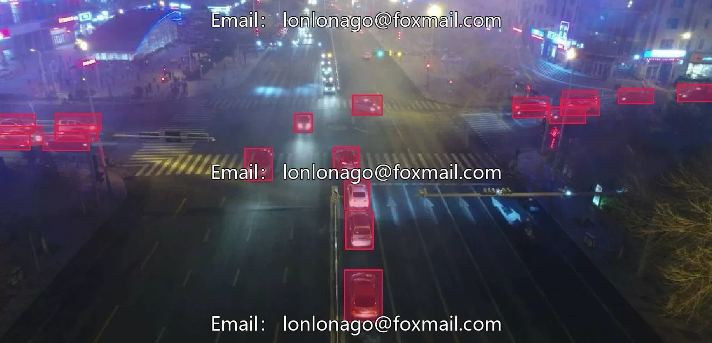

# UAV Night Street Inspection Data Set for Domestic Use, Low Light Conditions, Including 77819 Images

## Body

UAV Night Street Inspection Data Set for Domestic Use, Low Light Environment, comprising 77,819 images and 835,879 labeled targets, covering four categories: vehicles, cars, trucks, and buses. The dataset is divided into a training set of 24,143 images and a test set of 53,676 images. It supports tasks such as object detection, single-object tracking, multi-object tracking, etc., suitable for applications in drone security, search and rescue, sports analysis, and other fields.

The data format is JPEG, 1080×540 pixels. It supports download in Supervisely format and original resource can be obtained.

Virtual materials, once sold, are non-refundable.
Interested friends, click "I want" to proceed.

## Images

## Payment

Here is a pay link on Stripe ( https://buy.stripe.com/3cs8yP7sY87d0vu9AB ). Please contact me lonlonago@foxmail.com after funding $89, and I will send you a complete data files , thank you!

